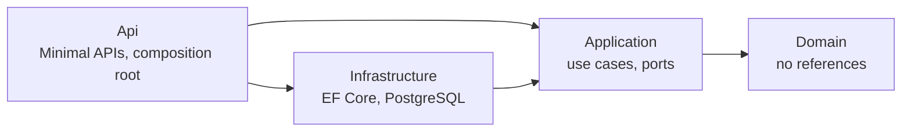

# BookingSystem

A REST API for reserving shared spaces (meeting rooms, sports courts, offices) that never double-books a slot,
built with .NET 10, Clean Architecture and Domain-Driven Design.

[](https://github.com/<OWNER>/<REPO>/actions/workflows/ci.yml)
[](https://github.com/<OWNER>/<REPO>/actions/workflows/codeql.yml)
[](LICENSE)
[](https://dotnet.microsoft.com/)

[Leer el resumen en español](README.es.md)

## Why this project exists

This is a portfolio project. It shows how I build a backend that stays correct under concurrency and stays easy
to change: a framework-free domain model with explicit business rules, a database that is the final arbiter
against race conditions, tests at every level (including mutation and architecture tests), and the delivery
work around it: containers, CI/CD, security scanning and documented decisions.

## Quick start

Requirements: [Docker](https://docs.docker.com/get-docker/) with Docker Compose v2. No .NET SDK is needed to run it.

```bash
git clone https://github.com/<OWNER>/<REPO>.git
cd <REPO>
cp .env.example .env        # then replace POSTGRES_PASSWORD with your own value
docker compose up --build   # add -d to run in the background
```

Compose starts PostgreSQL, applies the migrations with a one-shot `migrator` container, then starts the API
once the database is ready. The API listens on <http://localhost:8080> (if port 8080 or 5432 is taken, change
`API_PORT` or `POSTGRES_PORT` in `.env`):

```bash
curl http://localhost:8080/health/ready
# Healthy

# Create a room
curl -s -X POST http://localhost:8080/api/v1/rooms \
  -H "Content-Type: application/json" \
  -d '{"name":"Meeting Room A","capacity":8,"hourlyRate":25.00,"currency":"USD"}'
# {"id":"<room-id>"}

# Book it (start must be in the future, at most 100 days ahead; ISO 8601 with any offset)
curl -s -X POST http://localhost:8080/api/v1/bookings \
  -H "Content-Type: application/json" \
  -d '{"roomId":"<room-id>","userId":"3f2504e0-4f89-41d3-9a0c-0305e82c3301",
       "start":"<YYYY-MM-DD>T10:00:00Z","end":"<YYYY-MM-DD>T12:00:00Z","attendees":4}'
# {"id":"<booking-id>"}   (201 Created)

# An overlapping booking for the same room is rejected
curl -s -X POST http://localhost:8080/api/v1/bookings \
  -H "Content-Type: application/json" \
  -d '{"roomId":"<room-id>","userId":"3f2504e0-4f89-41d3-9a0c-0305e82c3301",
       "start":"<YYYY-MM-DD>T11:00:00Z","end":"<YYYY-MM-DD>T13:00:00Z","attendees":2}'
# 409 {"title":"Conflict","status":409,"code":"Booking.Overlapping",
#      "detail":"The time slot overlaps with an existing booking for this room.","traceId":"..."}
```

**OpenAPI UI.** The container runs in `Production`, where the OpenAPI document and the
[Scalar](https://scalar.com/) UI are not exposed. To browse them, set `API_ENVIRONMENT=Development` in `.env`
and run `docker compose up -d` again. Then open:

- Scalar UI: <http://localhost:8080/scalar>
- OpenAPI document: <http://localhost:8080/openapi/v1.json>

Stop everything with `docker compose down` (add `-v` to delete the database volume).

### Running from source

With the [.NET 10 SDK](https://dotnet.microsoft.com/download), start only the database and run the API with
`dotnet run`. In `Development` it applies pending migrations on startup and serves Scalar at
<http://localhost:5249/scalar>.

```bash
docker compose up -d postgres
export ConnectionStrings__Database="Host=localhost;Port=5432;Database=booking_system;Username=booking;Password=<your-password>"
dotnet run --project src/BookingSystem.Api --launch-profile http
```

`src/BookingSystem.Api/BookingSystem.Api.http` has ready-made requests. The connection string can also be stored with
`dotnet user-secrets` (`--project src/BookingSystem.Api`); it is never stored in `appsettings*.json`.

## Architecture

Four projects with an inward-only dependency rule, enforced by architecture tests:



- **Domain:** `Room` and `Booking` aggregates, `BookingService` (rules that span both), `CancellationPolicy`,
  value objects (`TimeSlot`, `Money`, strongly typed ids). No package references, never reads the clock.
- **Application:** CQRS with MediatR. Commands go through aggregates and `IUnitOfWork`; queries project straight
  to DTOs. Logging and validation (FluentValidation) run as pipeline behaviors. Every handler returns `Result`.
- **Infrastructure:** EF Core 10 with Npgsql, an exclusion constraint against overlapping bookings, optimistic
  concurrency on `xmin`, and domain events published after the commit.
- **Api:** versioned Minimal APIs (`/api/v1`), RFC 9457 problem details with stable error `code`s, rate limiting
  and health checks.

More detail, with the booking state machine and the sequence of a booking request (including the race that ends
in a 409): **[docs/architecture.md](docs/architecture.md)**. Decisions and trade-offs:
**[docs/adr](docs/adr/README.md)**.

## Endpoints

All routes are under `/api/v1`. Errors are problem details with `code` and `traceId`; any route can also return
`429` (rate limit) or `500`.

| Method | Route | Description | Success | Errors |
|---|---|---|---|---|
| `POST` | `/rooms` | Create a room | 201 | 400, 409 |
| `GET` | `/rooms` | List rooms, optionally `?isActive=true\|false` | 200 | 400 |
| `GET` | `/rooms/{id}` | Get a room | 200 | 400, 404 |
| `PUT` | `/rooms/{id}` | Update a room's name, capacity and rate | 204 | 400, 404, 409 |
| `POST` | `/rooms/{id}/activate` | Activate a room | 204 | 400, 404, 409 |
| `POST` | `/rooms/{id}/deactivate` | Deactivate a room | 204 | 400, 404, 409 |
| `GET` | `/rooms/available` | Rooms free for `?start=&end=&minCapacity=` | 200 | 400 |
| `POST` | `/bookings` | Book a room (pending) | 201 | 400, 404, 409 |
| `GET` | `/bookings/{id}` | Get a booking | 200 | 400, 404 |
| `POST` | `/bookings/{id}/confirm` | Pending → Confirmed | 204 | 400, 404, 409 |
| `POST` | `/bookings/{id}/cancel` | Cancel; returns the refund | 200 | 400, 404, 409 |
| `POST` | `/bookings/{id}/complete` | Confirmed → Completed, after the slot ends | 204 | 400, 404, 409 |
| `GET` | `/users/{userId}/bookings` | A user's bookings, `?status=&page=&pageSize=` (max 100) | 200 | 400 |

Outside the versioned API: `GET /health/live` (process is up) and `GET /health/ready` (PostgreSQL reachable).

## Testing

| Category | Project | Tests | Needs Docker |
|---|---|---|---|
| Unit | `BookingSystem.UnitTests` | 316 (incl. FsCheck property-based tests) | No |
| Integration | `BookingSystem.IntegrationTests` | 86 (PostgreSQL via Testcontainers, HTTP via `WebApplicationFactory`) | Yes |
| Architecture | `BookingSystem.ArchitectureTests` | 39 (ArchUnitNET) | No |

```bash
dotnet test                                     # everything (Docker must be running)
dotnet test --filter "Category!=Integration"    # fast suite, no Docker
scripts/coverage.sh                             # all tests + coverage report + thresholds
scripts/mutation.sh                             # Stryker.NET on Domain and Application
```

Measured on the 1.0.0 code (2026-10-16):

| Metric | Domain | Application | Infrastructure | Api | Global | Threshold |
|---|---|---|---|---|---|---|
| Line coverage | 100 % | 99.14 % | 99.65 % | 87.73 % | 96.13 % | Domain 95 %, Application 90 %, global 85 % |
| Mutation score | 98.42 % | 98.28 % | not mutated | not mutated | | break below 70 % / 60 % |

Global branch coverage is 95.3 %. CI fails when a coverage threshold is not met, and the weekly mutation run fails
below the `break` thresholds. The strategy, the reasons behind the thresholds and the equivalent mutants are in
[docs/testing/strategy.md](docs/testing/strategy.md) and [docs/testing/mutation-notes.md](docs/testing/mutation-notes.md).

## Continuous integration

| Workflow | Runs on | What it does |
|---|---|---|
| [`ci.yml`](.github/workflows/ci.yml) | push to `main`, pull requests | Format check, Release build with warnings as errors, vulnerable packages (fails on High/Critical), deprecated packages (report), unit, architecture and integration tests, coverage with thresholds (report as artifact and job summary), gitleaks over the full history |
| [`codeql.yml`](.github/workflows/codeql.yml) | push, pull requests, weekly | CodeQL `security-and-quality` analysis of C# |
| [`mutation.yml`](.github/workflows/mutation.yml) | weekly, manual | Stryker.NET; HTML reports as artifacts |
| [`docker.yml`](.github/workflows/docker.yml) | pull requests, tags `v*.*.*` | Builds the images on pull requests; on tags publishes `ghcr.io/<OWNER>/<REPO>` (amd64, arm64) and `ghcr.io/<OWNER>/<REPO>-migrator` (amd64) |
| [`release.yml`](.github/workflows/release.yml) | tags `v*.*.*` | GitHub Release with generated notes |

Dependabot updates NuGet packages, GitHub Actions and Docker images weekly. SonarQube Cloud can be enabled
optionally: [docs/optional/sonarcloud.md](docs/optional/sonarcloud.md).

## Project structure

```
.
├── src
│   ├── BookingSystem.Domain           # Aggregates, value objects, domain service, errors (no references)
│   ├── BookingSystem.Application      # Commands, queries, handlers, validators, behaviors, ports
│   ├── BookingSystem.Infrastructure   # EF Core/PostgreSQL, repositories, read queries, unit of work, migrations
│   └── BookingSystem.Api              # Minimal API endpoints, contracts, problem details, composition root
├── tests
│   ├── BookingSystem.UnitTests
│   ├── BookingSystem.IntegrationTests
│   ├── BookingSystem.ArchitectureTests
│   └── BookingSystem.TestUtilities    # Test data builders shared by the test projects
├── docs
│   ├── architecture.md                # Diagrams: layers, booking lifecycle, create-booking sequence
│   ├── adr/                           # Architecture decision records
│   ├── testing/                       # Test strategy and mutation testing notes
│   └── optional/                      # Optional integrations (SonarQube Cloud)
├── docker/healthcheck                 # HTTP probe used by the container HEALTHCHECK
├── scripts                            # coverage, mutation testing, vulnerable-package check
├── .github                            # Workflows, Dependabot, issue and PR templates
├── Dockerfile                         # API (default target) and migrator images
├── docker-compose.yml                 # postgres + migrator + api
└── Directory.Build.props              # Shared build settings and version
```

## Key design decisions

- [Clean Architecture](docs/adr/0001-clean-architecture.md): dependencies point to a framework-free domain.
- [CQRS without Event Sourcing](docs/adr/0002-cqrs-without-event-sourcing.md): aggregates for writes, SQL projections for reads.
- [Result pattern](docs/adr/0003-result-pattern.md): expected failures are values; exceptions are bugs.
- [Exclusion constraint](docs/adr/0004-postgresql-exclusion-constraint.md): PostgreSQL settles concurrent bookings; the in-memory check alone cannot.
- [Minimal APIs](docs/adr/0005-minimal-apis.md): one small class per endpoint, discovered automatically.
- [Post-commit domain events](docs/adr/0006-post-commit-domain-events.md): at-most-once; the Outbox is the documented next step.
- [MediatR 12.x](docs/adr/0007-mediatr-12-for-licensing.md): the last Apache-2.0 line.
- [No authentication in v1](docs/adr/0008-no-authentication-yet.md), with a path to JWT/OIDC.
- [Time as a parameter](docs/adr/0009-time-as-a-parameter.md): the domain never reads the clock.
- [Testing strategy](docs/adr/0010-testing-strategy.md): pyramid, mutation testing and architecture tests.

The container image is built on Ubuntu Chiseled (`aspnet:10.0-noble-chiseled`): no shell or package manager, and
a non-root user. Because the image has no `curl`, its `HEALTHCHECK` runs a 7 KB .NET probe
([docker/healthcheck/HealthProbe.cs](docker/healthcheck/HealthProbe.cs)) on the runtime that is already there.
Migrations run as a separate EF Core migration bundle; the API never migrates itself outside `Development`.

## Known limitations

- **No authentication or authorization.** `userId` travels in the request and any caller can act on any booking
  ([ADR 0008](docs/adr/0008-no-authentication-yet.md)). Do not expose the API publicly as is.
- **Domain events are at-most-once.** A crash between the commit and the publish loses them
  ([ADR 0006](docs/adr/0006-post-commit-domain-events.md)). Notifications are only a logging stub.
- **Deactivating a room does not touch its existing bookings.** `RoomDeactivatedDomainEvent` is raised, but no
  handler cancels or notifies the affected bookings yet.
- **`GET /rooms` is not paginated.** It returns every room; only a user's bookings are paginated.
- **Room name races surface as `500`.** Two simultaneous requests creating rooms with the same name: the unique
  index rejects the second one, but that violation is not translated into a `409` yet.
- **The rate limiter is in-memory and per instance,** partitioned by client IP. Behind a proxy it needs forwarded
  headers, and several instances do not share counters.
- **The migrator image is published for linux/amd64 only.** `dotnet ef` cannot cross-build a migration bundle for
  another CPU architecture. Building locally with `docker compose` works on both amd64 and arm64.

## Roadmap

- JWT bearer authentication against an OIDC provider, ownership checks and per-user rate limiting.
- Transactional Outbox for at-least-once domain events, and real notifications.
- Cancel and notify bookings when a room is deactivated.
- Pagination for `GET /rooms`; translate the unique-name violation into `409`.
- OpenTelemetry traces and metrics.
- Replace MediatR 12.x with a source-generated mediator; move the tests to xUnit v3 (`xunit` 2.x is deprecated).
- Deployment to a managed container platform with managed PostgreSQL.

## License

[MIT](LICENSE)
