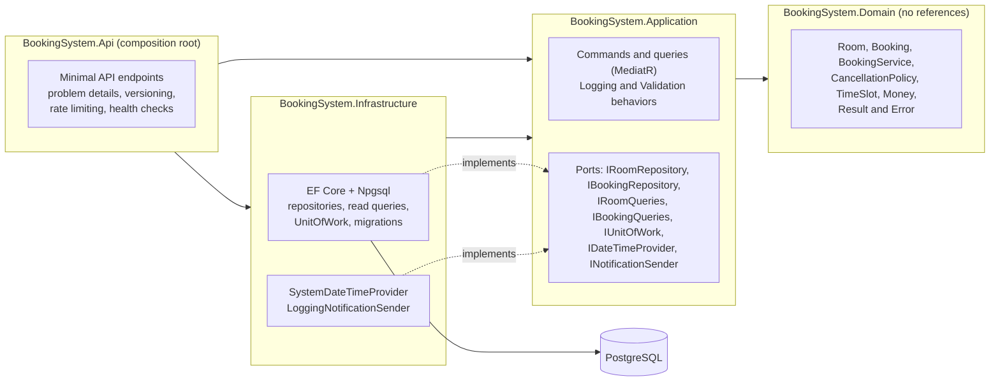
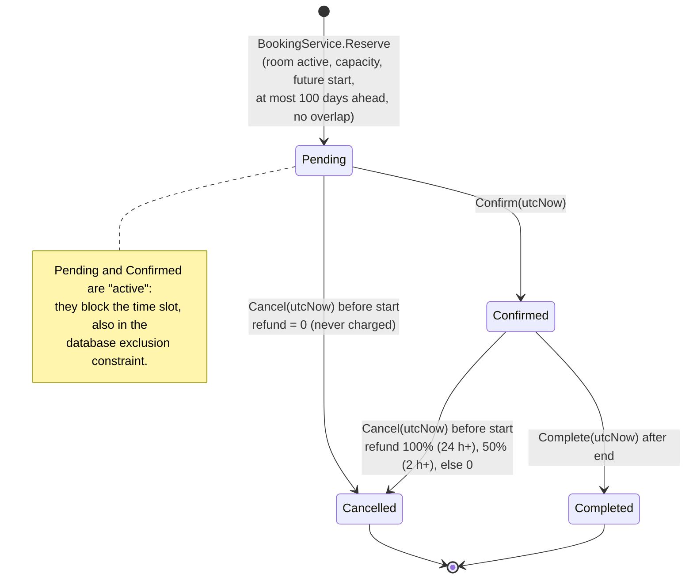
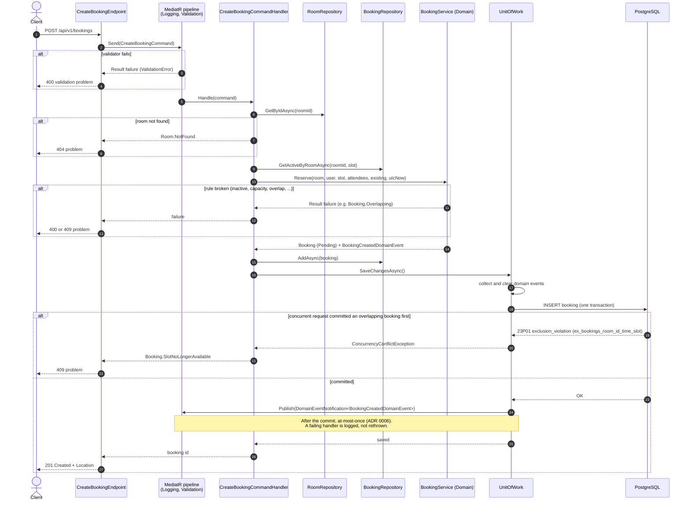

# Architecture

BookingSystem follows Clean Architecture: four projects, and every dependency points toward the domain.
The reasons behind each decision are recorded in the [ADRs](adr/README.md).

## Layers and dependency direction

Solid arrows are project references. Infrastructure implements the ports declared by Application (dotted arrows),
so Application never references EF Core or ASP.NET Core. `BookingSystem.ArchitectureTests` enforces these rules.

## Booking lifecycle

Every other transition returns an error instead of throwing: `Booking.NotPending`, `Booking.NotCancellable`,
`Booking.NotConfirmed`, `Booking.NotYetEnded`, and `Booking.AlreadyStarted` when cancelling after the start.
Each successful transition raises a domain event (`BookingCreated`, `BookingConfirmed`, `BookingCancelled`,
`BookingCompleted`).

## Creating a booking

Two checks protect against double booking ([ADR 0004](adr/0004-postgresql-exclusion-constraint.md)):
`BookingService.Reserve` rejects overlaps with the active bookings it is given and returns a precise
`Booking.Overlapping`; the exclusion constraint settles the race when two requests pass that check at the same
time, and the loser gets `Booking.SlotNoLongerAvailable`. Both map to `409 Conflict`.
